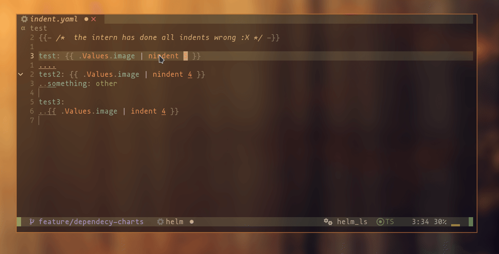
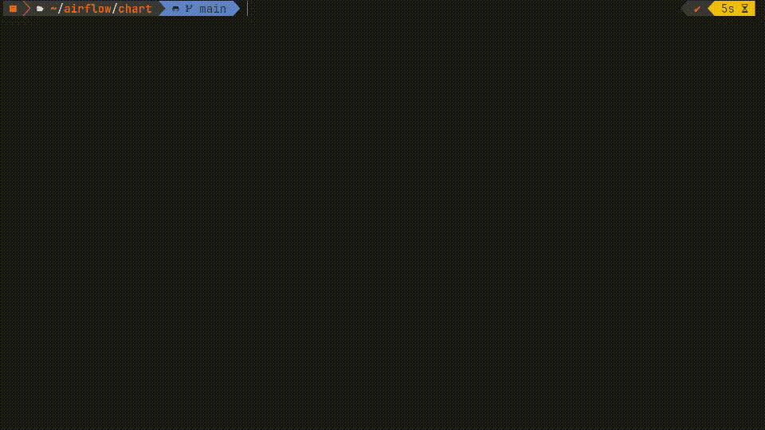

# Nvim plugin for helm-ls

A Neovim lua plugin for [Helm](https://helm.sh/) adding additional features using [helm-ls](https://github.com/mrjosh/helm-ls/).
The plugin can be used as an alternative to [towolf/vim-helm](https://github.com/towolf/vim-helm) for Neovim.

The plugin is in early development.

## Features

- File types for Helm (including values.yaml files required for helm-ls)
- Highlight the current block (`if`, `with`, `range`, etc.)
- Jump between the start and end of a block with `%`
- experimental: Overwrite templates with their current values using virtual text (See [Demos](#demos))
  - Note: Setting `vim.opt.conceallevel = 2` is recommended for correct handling of wrapped lines.
- experimental: Show hints highlighting the effect of `nindent` and `indent` functions (See [Demos](#demos))
- Toggle features (`indent_hints`, `conceal_templates`, `action_highlight`) at runtime (see [Functions](#functions))

## Keymaps

The plugin adds the following keymaps for helm files:

- `%`: Jump between the start and end of a block (`if`, `with`, `range`)

## Installing

### Using `lazy.nvim`

```lua
{
    "qvalentin/helm-ls.nvim",
    ft = "helm",
    opts = {
        -- leave empty or see below
    },
}
```

If you are not using lazy, make sure to call `require("helm-ls").setup()` in your Lua config.

### Requirements

The plugin requires [helm-ls](https://github.com/mrjosh/helm-ls) and the helm tree-sitter grammar for the additional features.
Install the helm tree-sitter grammar using `TSInstall` after installing the [nvim-treesitter plugin](https://github.com/nvim-treesitter/nvim-treesitter).

```
:TSInstall helm
```

## Configuration

Default config:

```lua
{
  conceal_templates = {
    -- enable the replacement of templates with virtual text of their current values
    -- note: for better wrapping support, set `vim.opt.conceallevel = 2`
    enabled = true, -- this might change to false in the future
  },
  indent_hints = {
    -- enable hints for indent and nindent functions
    enabled = true,
    -- show the hints only for the line the cursor is on
    only_for_current_line = true,
    -- show the hints on the same line where indent and nindent functions are
    hint_on_same_line = false,
    -- highlight group: nil|"HelmIndentHint"|any string
    hl_group = nil,
    -- hint color
    -- hl_link has more priority: hl_bg will work only when hl_link = nil
    hl_link = nil, -- link to predifined highlighting group from your theme (e.g. "CursorLine") (see :help hi-link) (does not work without hl_group)
    hl_bg = nil, -- background color (e.g. red or "#2a2e42") applied to hl group (does not work without hl_group)
  },
  action_highlight = {
    -- enable highlighting of the current block
    enabled = true,
  },
}
```

## Functions

### `helm-ls.toggle({feature})`

Toggle a feature on or off at runtime.
When a feature is disabled, its virtual text and highlights are removed from all buffers.
The new state is shown in a notification.

- `feature`: `"indent_hints" | "conceal_templates" | "action_highlight"`
- returns: the new state (`boolean`), or `nil` if the feature is unknown

```lua
require("helm-ls").toggle("indent_hints")
```

### Features

All features can be enabled in the setup options (see [Configuration](#configuration)) and toggled at
runtime with `helm-ls.toggle()`:

- **`indent_hints`**: Highlights the effect of the `indent` and `nindent` template functions by
  underlining (by default) the indentation they add, so you can see how deeply the rendered text
  will be indented. By default hints are shown only for the line below the cursor(`only_for_current_line`);
  `hint_on_same_line` places the hint on the function's own line, and `hl_group`/`hl_link`/`hl_bg`
  customize the highlight.
- **`conceal_templates`**: Replaces template expressions like `{{ .Values.service.port }}` with
  their current values (queried from helm-ls and cached), shown as virtual text. The line the
  cursor is on is never concealed, so the template you are editing stays visible. Recommended:
  `vim.opt.conceallevel = 2` for correct handling of wrapped lines.
- **`action_highlight`**: While the cursor is inside an action block (`range`, `if`, `with`,
  `define`, `block`), the parts of that action are highlighted with the `Visual` highlight group,
  so you can see the boundaries of the control structure you are editing.

## Examples

This example starts the features disabled and toggles them with keymaps:

```lua
{
  'qvalentin/helm-ls.nvim',
  lazy = false,
  opts = {
    -- features start disabled ...
    conceal_templates = { enabled = false },
    indent_hints = {
      enabled = false,
      only_for_current_line = true,
      -- show the hint on the same line as the indent / nindent function
      hint_on_same_line = true,
      -- custom highlight group with an orange background
      hl_group = 'HelmIndentHint',
      hl_bg = '#EE9748',
    },
  },
  -- ... and are toggled with keymaps instead
  keys = {
    { '<leader>ct', function() require('helm-ls').toggle('conceal_templates') end, desc = 'Helm: toggle template concealing' },
    { '<leader>hl', function() require('helm-ls').toggle('indent_hints') end, desc = 'Helm: toggle indent hints' },
  },
}
```

## Demos

<video src="https://github.com/user-attachments/assets/efae6e15-58a7-48d4-99c2-fd74fbb3a1b0" width="100%" controls></video>



Color highlighted indent hints and template concealment demo:


